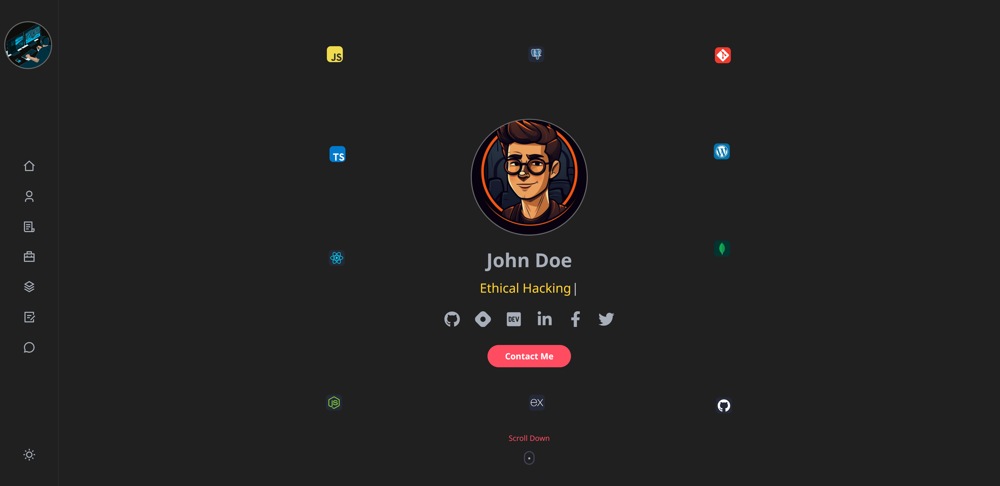

<h2 align="center">🧑 Personal Portfolio Website 🎫</h2>

• 📢 Personal Portfolio Website made with React, Node JS, NPM Packages "@emailjs/browser" for Send Email Directly From Your Code.

 

 
<h2 align="left">Live Preview: 🕹️ </h2>

    
• 🖥️  Personal Website Application&nbsp;
    
    

<h2 align="left">Languages and Tools : 🛠️ </h2>

    &nbsp;
    &nbsp;
    &nbsp;
    &nbsp;
    &nbsp;

<!-- /////////////////////////////////////////////// Personal Website ////////////////////////////////////////////////// -->
